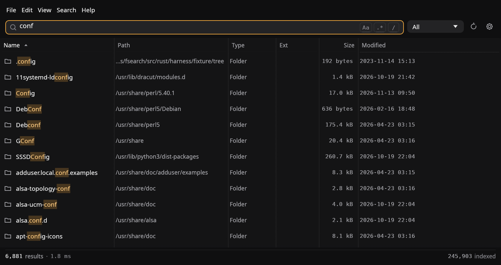
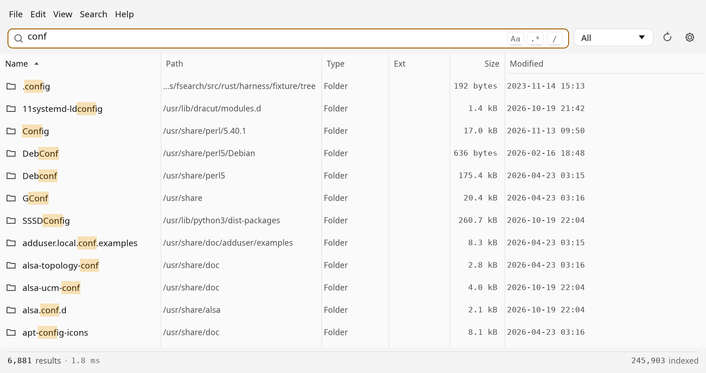
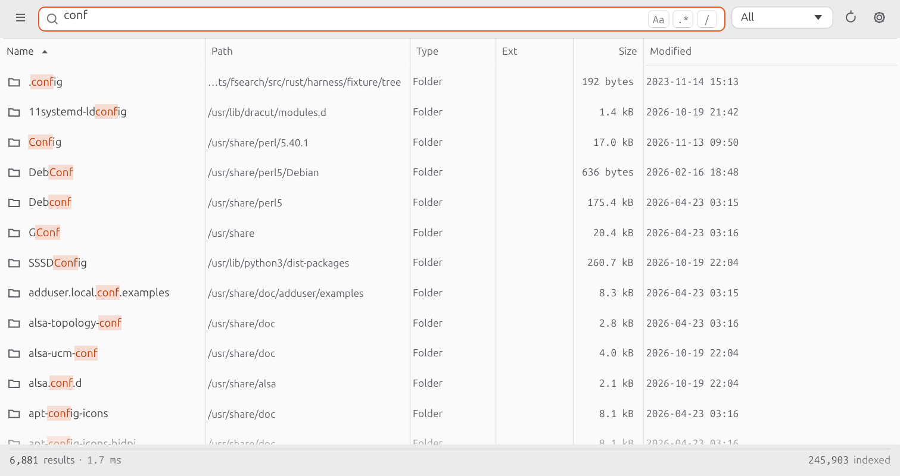
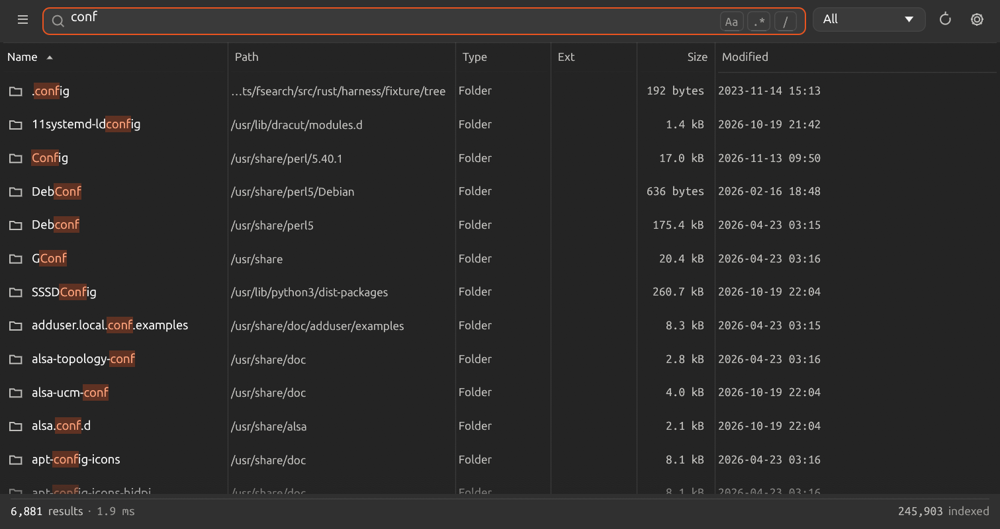
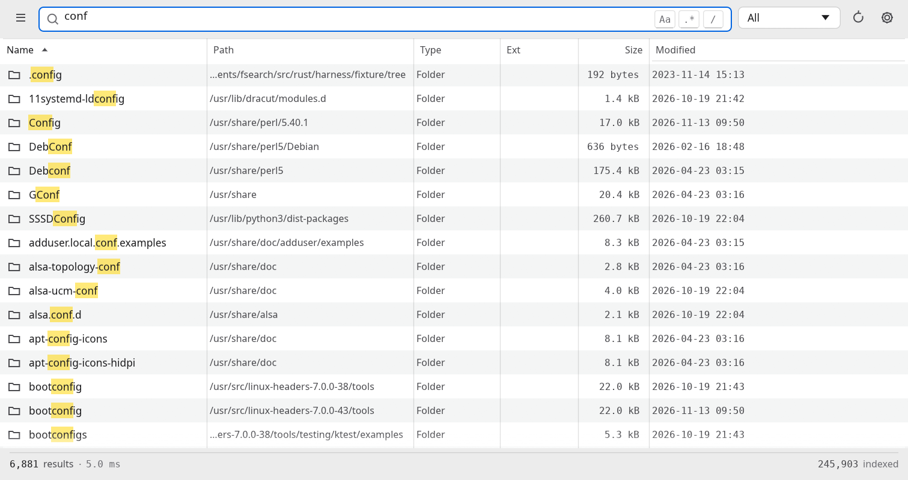
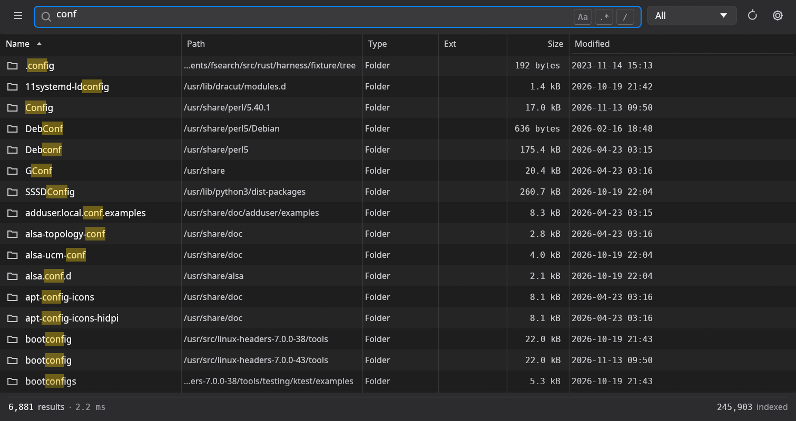
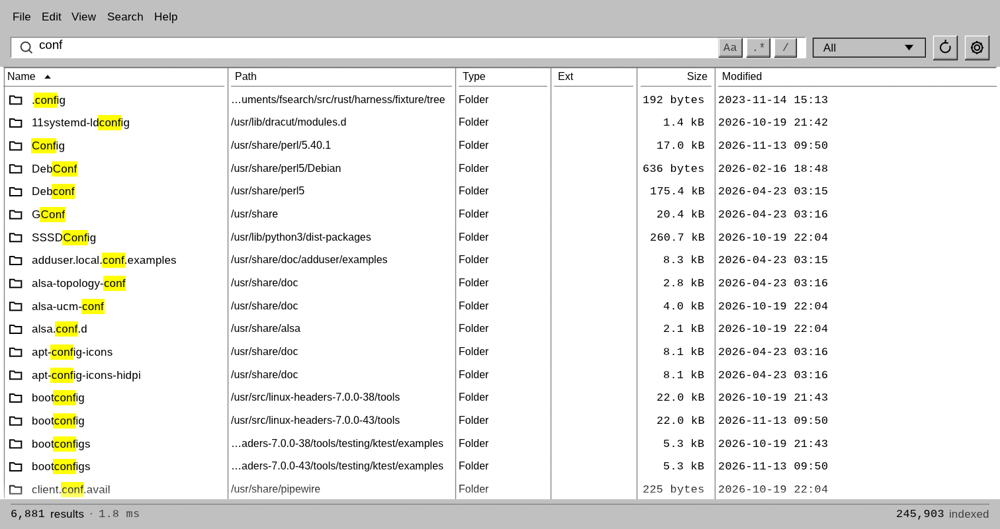
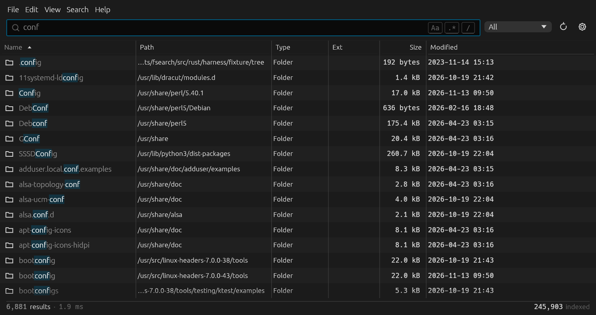

# FSearch (Rust)

A fast file search utility for Linux, Windows and macOS, rewritten in Rust from
[FSearch](https://github.com/cboxdoerfer/fsearch) by Christian Boxdörfer. It indexes your folders once and
then finds files by name or path as you type, with wildcards, regular expressions, filters and the original's
full search syntax (`ext:`, `size:`, `dm:`, `regex:`, `case:`, `path:`, `AND`/`OR`/`NOT`, …).



- **Same behavior as the original.** Every query, sort order and command-line output was checked against the
  C program: 400 recorded app cases and over 23,000 fuzzed queries give identical results.
- **The index file is compatible.** `fsearch.db` and `fsearch.conf` are read and written byte for byte like the
  original, so you can switch between the two.
- **Faster.** Updating an index of 876,000 entries takes 0.61 s instead of 4.15 s; queries are 2.4× faster
  overall and sorting by Type is instant instead of 1.4 s. Details in [docs/BENCHMARK.md](docs/BENCHMARK.md).
- **One binary, no GTK.** The interface is drawn with [egui](https://github.com/emilk/egui) and runs on Linux
  (X11 & Wayland), Windows 10/11 and macOS (Universal 2: Apple Silicon & Intel).

## Looks

The look is chosen in Preferences → Appearance and applies immediately.

| Modern (dark and light) | Ubuntu (light and dark) |
| --- | --- |
|   |   |
| **macOS (light and dark)** | **Windows 95 and Classic FSearch** |
|   |   |

## Keyboard

| Action | Keys |
| --- | --- |
| Focus the search field | `Ctrl+F` |
| Match case, regular expressions, search in path | `Ctrl+I`, `Ctrl+R`, `Ctrl+U` |
| Update the index | `Ctrl+Shift+R` |
| Preferences | `Ctrl+P` |
| Open selection, open containing folder | `Enter`, `Ctrl+Enter` |
| Copy path, select all results | `Ctrl+C`, `Ctrl+A` |
| Move to trash | `Delete` |
| Search syntax help | `F1` |
| Hide or quit, quit | `Esc`, `Ctrl+Q` |

The toggles also sit as keycaps inside the search field, and every menu entry shows its shortcut.

## Command line

```
fsearch                      open the window (or bring a running one to the front)
fsearch -s PATTERN           open with a search
fsearch -u                   update the index and exit
fsearch --preferences        open the preferences
fsearch --minimized          start minimized
fsearch -v                   print the version
```

Settings live in `~/.config/fsearch/fsearch.conf` (Windows: `%APPDATA%\fsearch`), the index in
`~/.local/share/fsearch/fsearch.db` (Windows: `%LOCALAPPDATA%\fsearch`).

## Install

Download from the releases page:

- **AppImage**: `chmod +x FSearch-*-x86_64.AppImage` and run it. Needs glibc 2.34+ (Ubuntu 22.04, Debian 12,
  Fedora 35 or newer).
- **Linux installer**: `sh fsearch-*-linux-x86_64.sh` installs to `~/.local` with a menu entry;
  `--system` installs to `/usr/local`, `--uninstall` removes it.
- **Windows**: `FSearch-*-setup.exe`, or the portable zip.

## Build

Needs Rust 1.88 or newer (edition 2024) and a C compiler (PCRE2 is built from source).

```bash
cargo build --release          # target/release/fsearch
cargo test --release           # unit, query-table, UI and recorded app tests
cargo clippy --all-targets -- -D warnings
```

On Linux, egui needs the usual X11/Wayland development headers (`libxkbcommon-dev`, `libwayland-dev`,
`libgl1-mesa-dev` on Debian and Ubuntu).

### Packages

| Package | Command | Needs |
| --- | --- | --- |
| AppImage | `packaging/linux/build-appimage.sh` | `appimagetool-x86_64.AppImage` and `runtime-x86_64` in `packaging/linux/tools` |
| `.sh` installer | `packaging/linux/build-sh-installer.sh` | `sh`, `tar`, `gzip` |
| Windows setup and zip | `packaging/windows/build-windows.sh` | `rustup target add x86_64-pc-windows-gnu`, MinGW-w64, NSIS (`makensis`) |

## Layout

```
src/                 the application: CLI, window (src/gui), single-instance IPC
crates/fsearch-core  index, scanner, query parser and matcher, database and config formats
crates/fsearch-string-utils  string helpers ported from the original
tests/               recorded app cases (replayed against the binary)
tools/compat/        tools that compare this port with the C original (see its README)
docs/                benchmark, porting decisions, screenshots
packaging/           AppImage, .sh installer, Windows installer
```

## Credits and license

FSearch was created by Christian Boxdörfer and contributors; this is a port of it to Rust, keeping its search
syntax, file formats and behavior. Licensed under the GNU General Public License v2.0 or later, like the
original; see [LICENSE](LICENSE).
